# Employee-turnover-prediction-using-ML-approaches
"Employee turnover prediction Using Machine Learning approaches and performance analysis of ML algorithms", is a research project that I have completed as part of my Mastar's requirement. The goal is to help HR departments make data-driven decision to reduce employee attrition.

In this research, a machine-learning framework was developed for employee turnover prediction. comparing nine machine learning algorithms (Random Forest, Decision Tree, XGBoost, Gradient Boosting, Support Vector Machine, Logistic Regression, CatBoost, Gaussian Naïve Bayes and K-Nearest Neighbour) on structured HR data.

Two data sources were used, a primary dataset collected through surveys from 24 employees and secondary dataset from Kaggle (https://www.kaggle.com/datasets/ziya07/employee-attrition-prediction-dataset) comprising over 10,000 records. Key variables included job satisfaction, monthly income, tenure and work-life balance. Categorical variables were one-hot encoded, numerical features standardized and class imbalance addressed with SMOTE resampling.

### Exploratory Data Analysis (EDA)
EDA was conducted to identify trends and relationship between features. The analysis revealed higher turnover among early career employees (within first 2 years of employment) where 'Low compensation and lack of career growth' were major factors. Employees with 'poor work-life balance' were likely to leave.

  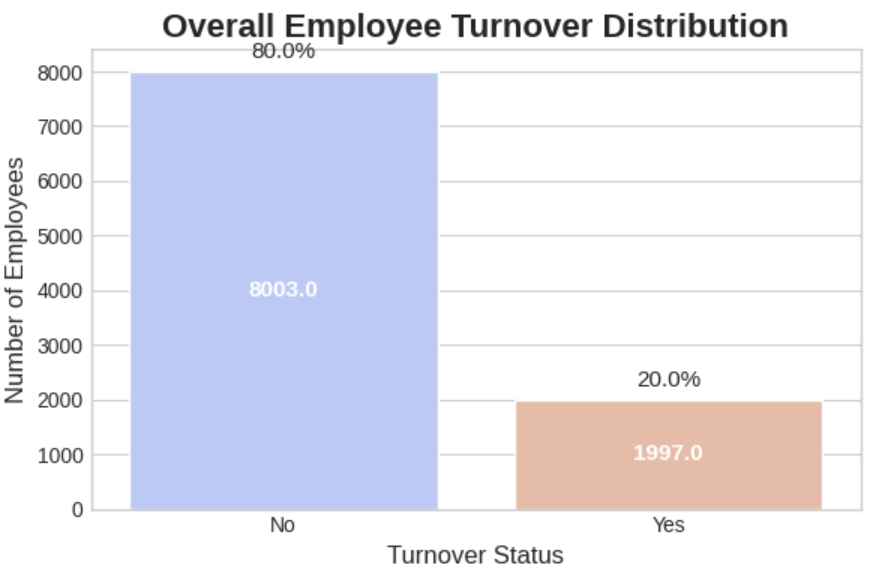 

The dataset shows a class imbalance, where the majority of the employees stay while a smaller portion leave. To address this issue SMOTE (Synthetic Minority Oversampling Technique) has been used. The following graphs shows a partial exploratory data analysis.

  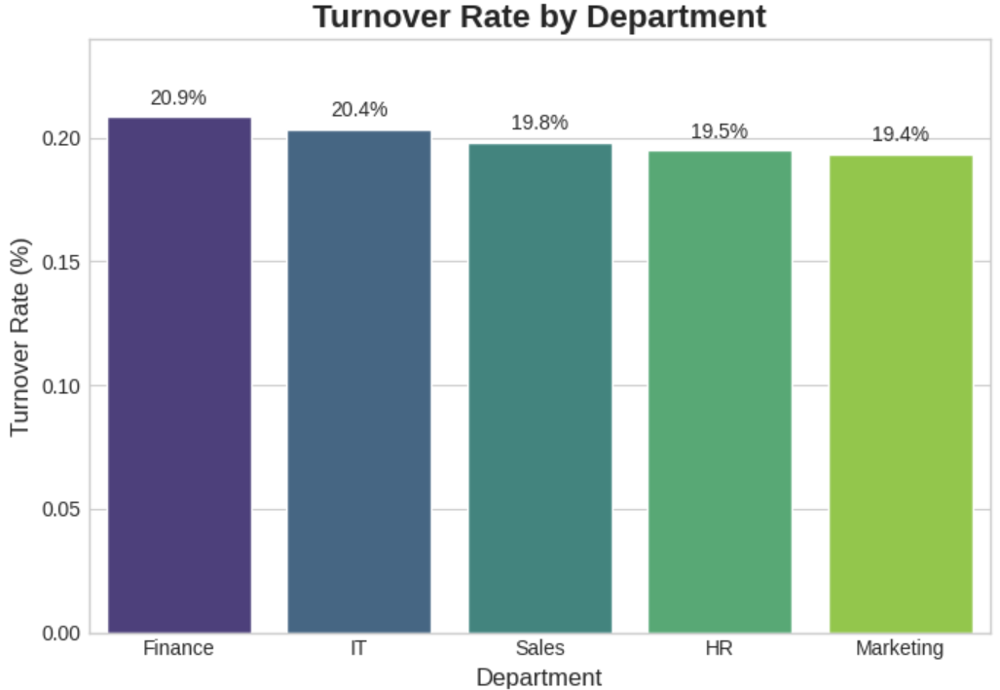
  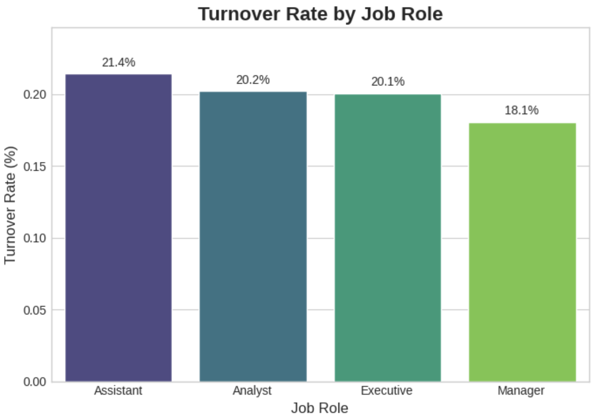 
  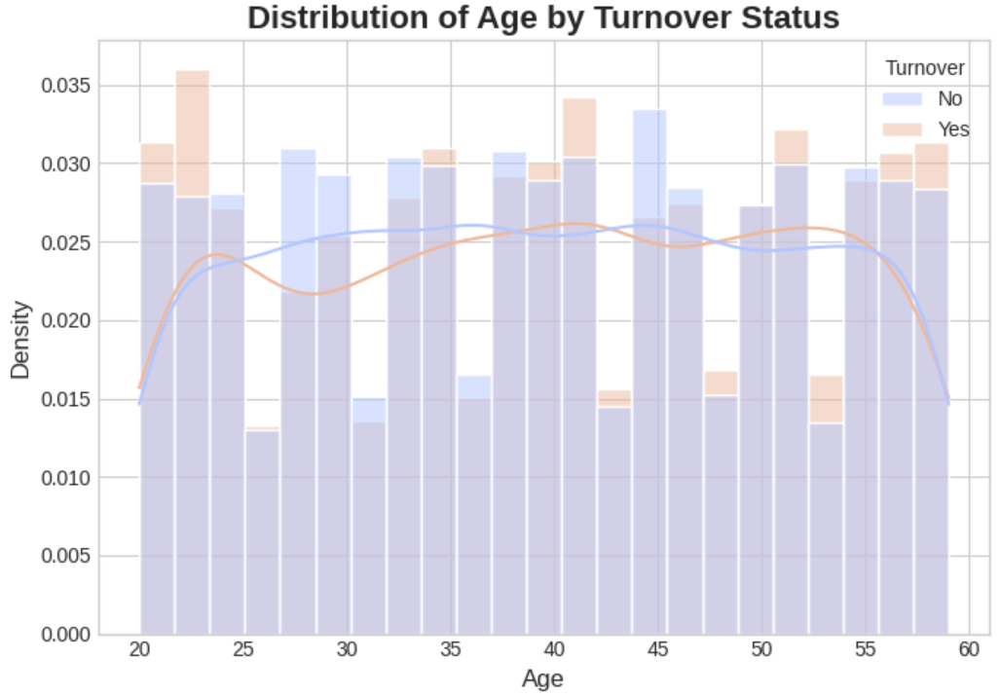
  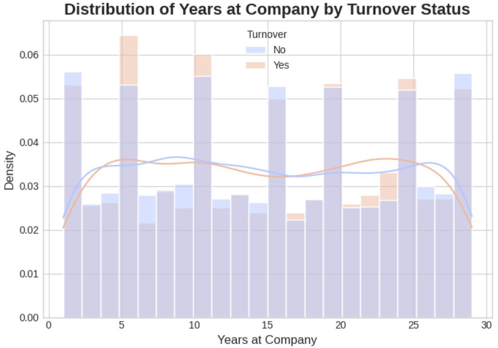 
  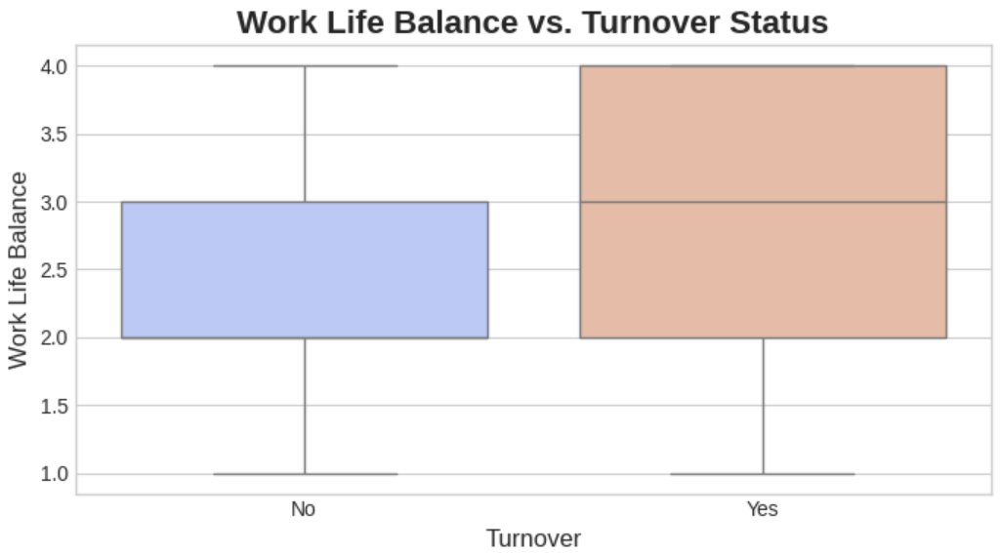
  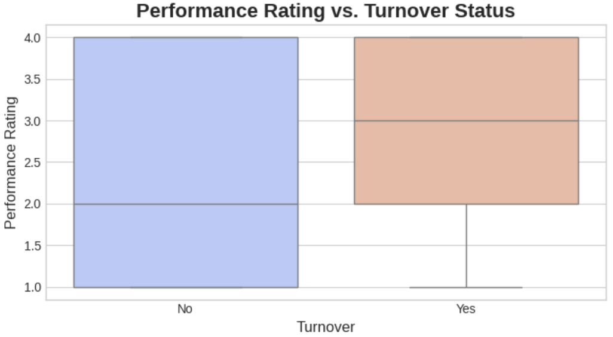

  <em> &nbsp;&nbsp;&nbsp;  &nbsp;&nbsp;&nbsp; </em>

### Machine Learning algorithm anlysis

Nine machine learning algorithms (Random Forest, Decision Tree, XGBoost, Gradient Boosting, Support Vector Machine, Logistic Regression, CatBoost, Gaussian Naïve Bayes and K-Nearest Neighbour) were implemented and compared. Several preprocessing steps were applied before modeling training such as irrelevent features removal, checked for missing values and so on. Categorical variables were encoded usimg "One-Hot Encoding".

Models were evaluated using multiple (Accuracy, Precision, Recall, F1 Score, ROC-AUC) matrics. Hyperparameter tuning was conducted to achieve effective machine learning performance. The following tables shows the evaluted result for each machine learning algorithms.

<em>Comparision of classifiers (train with secondary data) in different matrices (after Tuning)</em>

<table align="center">
<tr align="center">
  <td> </td>
  <td> Train accuracy </td>
  <td> Test accuracy </td>
  <td> Precision </td>
  <td> Re-call </td>
  <td> F!-score </td>
  <td> ROC-AUC </td>
</tr>
<tr align="center">
  <td> CatBoost </td>
  <td> 1.00 </td>
  <td> 0.88 </td>
  <td> 0.97 </td>
  <td> 0.79 </td>
  <td> 0.87 </td>
  <td> 0.93 </td>
</tr>
<tr align="center">
  <td> Random Forest </td>
  <td> 1.00 </td>
  <td> 0.87 </td>
  <td> 1.00 </td>
  <td> 0.74 </td>
  <td> 0.85 </td>
  <td> 0.93 </td>
</tr>
<tr align="center">
  <td> Gradient Boosting </td>
  <td> 0.88 </td>
  <td> 0.87 </td>
  <td> 1.00 </td>
  <td> 0.74 </td>
  <td> 0.85 </td>
  <td> 0.89 </td>
</tr>
<tr align="center">
  <td> XgBoosting </td>
  <td> 0.88 </td>
  <td> 0.87 </td>
  <td> 1.00 </td>
  <td> 0.73 </td>
  <td> 0.85 </td>
  <td> 0.88 </td>
</tr>
<tr align="center">
  <td> SVM </td>
  <td> 1.00 </td>
  <td> 0.86 </td>
  <td> 1.00 </td>
  <td> 0.72 </td>
  <td> 0.84 </td>
  <td> 0.99 </td>
</tr>
<tr align="center">
  <td> Decision Tree </td>
  <td> 0.90 </td>
  <td> 0.79 </td>
  <td> 0.81 </td>
  <td> 0.76 </td>
  <td> 0.78 </td>
  <td> 0.85 </td>
</tr>
<tr align="center">
  <td> Logistic Regression </td>
  <td> 0.54 </td>
  <td> 0.55 </td>
  <td> 0.55 </td>
  <td> 0.56 </td>
  <td> 0.56 </td>
  <td> 0.56 </td>
</tr>
</table>

<em>Comparision of classifiers (train with primary data) in different matrices (after Tuning)</em>

<table align="center">
<tr align="center">
  <td> </td>
  <td> Train accuracy </td>
  <td> Test accuracy </td>
  <td> Precision </td>
  <td> Re-call </td>
  <td> F!-score </td>
  <td> ROC-AUC </td>
</tr>
<tr align="center">
  <td> Gaussian Naïve Bayes  </td>
  <td> 1.00 </td>
  <td> 0.83 </td>
  <td> 1.00 </td>
  <td> 0.50 </td>
  <td> 0.67 </td>
  <td> 0.69 </td>
</tr>
<tr align="center">
  <td> KNN </td>  
  <td> 1.00 </td>
  <td> 0.83 </td>
  <td> 1.00 </td>
  <td> 0.50 </td>
  <td> 0.67 </td>
  <td> 0.75 </td>
</tr>
<tr align="center">
  <td> Random Forest </td>
  <td> 1.00 </td>
  <td> 1.00 </td>
  <td> 1.00 </td>
  <td> 1.00 </td>
  <td> 1.00 </td>
  <td> 1.00 </td>
</tr>
<tr align="center">
  <td> Decision Tree </td>
  <td> 1.00 </td>
  <td> 1.00 </td>
  <td> 1.00 </td>
  <td> 1.00 </td>
  <td> 1.00 </td>
  <td> 1.00 </td>
</tr>  
</table>

According to the model performance shown in first table (secondary data), the Random Forest model had the highest precision (1.00), meaning all predicted leavers were actual leavers, but its recall (0.74) implied it missed a notable number of cases. CatBoost offered the best balance (precision = 0.97, recall = 0.79). Gradient Boosting, XGBoost and SVM had moderately higher precision and lower recall, indicating more false positives and accurate true positives. Besides, SVM has the highest ROC AUC (0.99) among all the classifiers. The decision tree has the lowest balanced performance, and the performance of the Logistic regression was not acceptable, and the accuracy and precision were 0.55, and recall and ROC-AUC was 0.56. In model performance (second table) with primary data, both Gaussian Naïve Bayes and KNN have a similar performance though ROC-AUC of KNN has ignorable increase. As the primary dataset is very small, the trained model wast not performed well.

Overall, Random Forest and SVM stand out for its precision and ROC performance, Decision tree, XGBoost and Gradient Boosting for their overall balance, and CatBoost for better recall in detecting at-risk employees. The choice among them should be guided by organisational priorities: whether the goal is to minimise false alarms (Random Forest/SVM), capture most attrition cases with some risk of false positives (CatBoost), or balance both outcomes effectively (Decision tree, XGBoost or Gradient Boosting). 

  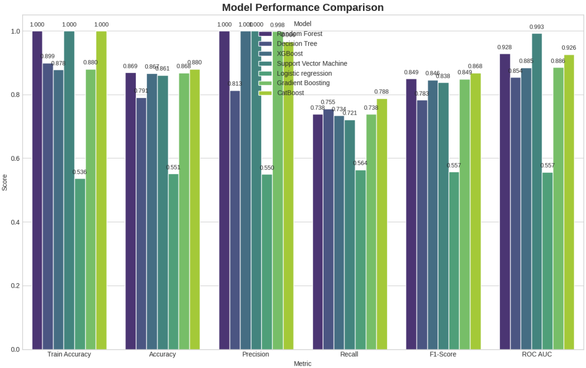

### Feature Importance

After training all classifiers on the pre-processed data, an importance-feature extraction workflow has been implemented to extract influential features. Across all seven models, the most influential predictors were: Overtime, gender, marital status, job role, job satisfaction, monthly income, job involvement, job level, project count, department (IT), years in current role, work environment satisfaction, number of companies worked, promotion, work life balance, performance rating, hourly rate, training hours, years at company, absenteeism, average working hours, age and relationship with manager. Top influential features for CatBoost, Random Forest, Support Vector Machine (SVM) and Gradient Boosting algorithms has been shown in the following graphs.

  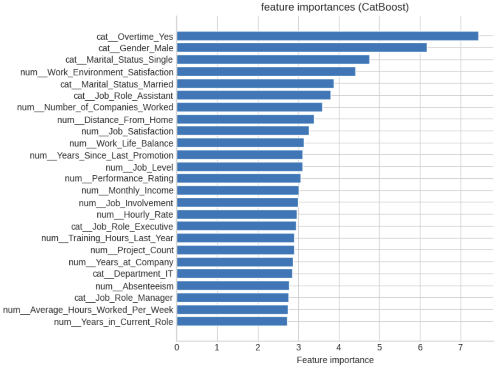
  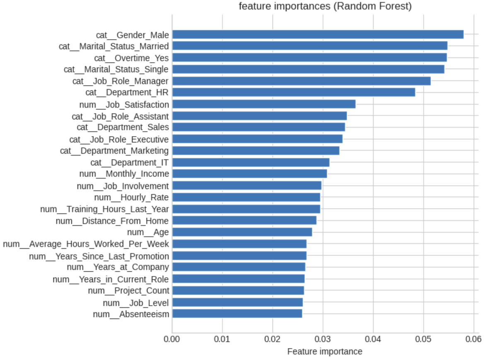 
  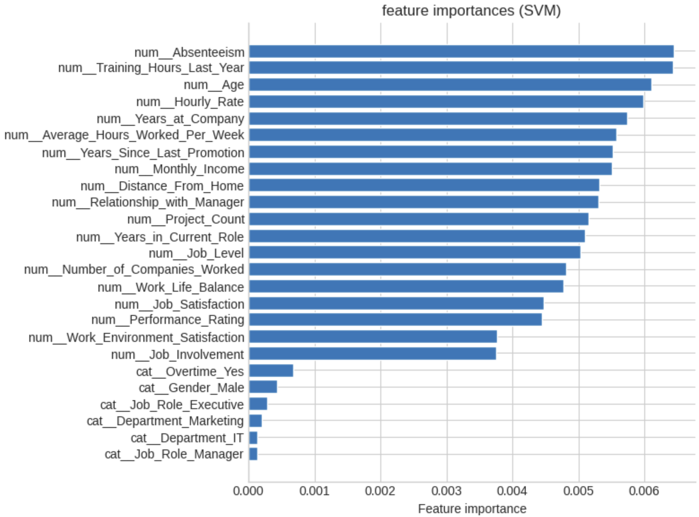
  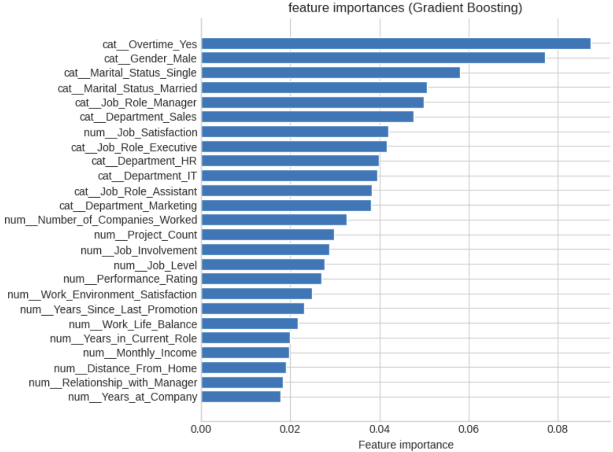 

now 

<figure>
  
  <figcaption>Figure 1: Model architecture</figcaption>
  
  <figcaption>Figure 2: Model architecture</figcaption>
</figure>

    

